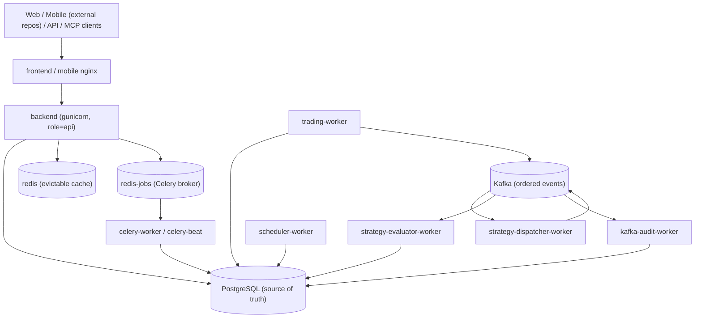

# QuantDinger Agent Onboarding

Onboarding reference for an AI agent (or a new contributor) picking up this
repository. It is a map: where things live, which process owns what, which
contracts must not break, and how to verify a change.

Read [AGENTS.md](AGENTS.md) first. That file is the canonical rule set for coding
agents and always wins over this document. This document adds the architecture
and workflow detail that the rule set intentionally keeps thin. The working
agreement recorded in [Working Agreement](#working-agreement-verbatim) is part
of the rule set for this repository.

Baseline: `main` @ `ba8cd66`, source version `5.5.1` ([VERSION](VERSION)).

## 1. What this repository is

QuantDinger is a self-hosted AI trading platform. The repository contains the
**backend, all worker processes, the Agent Gateway, the MCP server package,
deployment definitions, operations configuration, and documentation**. The Vue
web client and the mobile client live in separate repositories; this repository
consumes their published container images.

- Python 3.12, Flask 3.1 + flask-smorest, gunicorn (`gthread`), Celery,
  confluent-kafka, psycopg2.
- PostgreSQL 18 is the durable source of truth. Kafka is the ordered event
  backbone. Redis is an evictable cache; the jobs Redis is the durable Celery
  broker/result tier.
- Everything runs as containers from **one backend image with different
  commands** and different `QD_PROCESS_ROLE` values.

It is not a library and not a single application. Treat a change as incomplete
until you know **which process executes it** and **which store is authoritative
for it**.

## 2. First ten minutes

```bash
# Orientation
git log --oneline -20                     # recent work is release hardening
python backend_api_python/scripts/backend_quality_check.py   # structure guard
python scripts/check_docs.py && python scripts/check_version.py

# Environment
ls .env.example docker-compose*.yml       # topology and configuration surface
python scripts/sync_env.py --check --env-file .env --template .env.example

# Focused tests (from backend_api_python/)
cd backend_api_python
python -m pytest tests/test_process_roles.py -q
```

## 3. Repository map

| Path | Responsibility |
| --- | --- |
| `backend_api_python/app/__init__.py` | `create_app()` factory: JSON provider, CORS, observability, secret guard, DB bootstrap, route registration, startup hooks. |
| `backend_api_python/app/startup.py` | Role-gated startup hooks and process-local service singletons. |
| `backend_api_python/app/runtime/` | `ProcessRole` enum and process helpers. |
| `backend_api_python/app/commands/` | Process entrypoints: `migrate`, `kafka_topics`, `trading_worker`, `strategy_dispatcher_worker`, `strategy_evaluator_worker`, `kafka_audit_worker`, `scheduler`, `worker_health`, `sync_env`. |
| `backend_api_python/app/routes/` | Human HTTP blueprints. `agent_v1/` is the Agent Gateway. Routes validate and delegate only. |
| `backend_api_python/app/openapi/` | flask-smorest API definition, shared schemas, tag map, `enrich_spec`, health routes. |
| `backend_api_python/app/services/` | Domain workflows. `strategy_v2/` (contract + engines + live gateway), `strategy_runtime/`, `live_trading/`, `grid/`, `pending_orders/`, `backtest/`, `factors/`, `strategy_evolution/`, `portfolio/`, `notifications/`, `usdt_payment/`, `quick_trade/`, `ai_*`, `llm.py`, `professional_report/`. |
| `backend_api_python/app/events/` | Event protocol, topics, Kafka producer/consumer, bar clock, dispatcher, evaluator. |
| `backend_api_python/app/workers/`, `app/tasks/` | Long-lived worker shells and finite Celery jobs. |
| `backend_api_python/app/data_sources/`, `app/data_providers/`, `app/markets/` | Raw provider adapters, aggregated dashboard providers, market registry and symbol catalog. |
| `backend_api_python/app/utils/` | Database, cache, auth, agent auth, credential crypto, safe execution, risk and resource guards. |
| `backend_api_python/app/observability/` | Prometheus metrics, HTTP instrumentation, DB pool metrics. |
| `backend_api_python/migrations/` | Canonical `init.sql` plus dated delta migrations and seed files. |
| `backend_api_python/tests/` | Unit, contract, integration, and release-gate tests. |
| `mcp_server/` | Standalone `quantdinger-mcp` package wrapping the Agent Gateway. |
| `docs/` | Architecture, deployment, trading, agent, API, product, and security documentation. |
| `ops/` | Prometheus, Grafana, and Alertmanager configuration. |
| `scripts/` | Repository-level checks and release tooling. |

## 4. Runtime architecture

### 4.1 Process roles

One image, many roles. Each entrypoint sets `QD_PROCESS_ROLE` before building the
app; `create_app(register_http_routes=False)` is used for non-HTTP roles.

| Role | Owns | Must not own |
| --- | --- | --- |
| `api` | HTTP, authentication, validation, durable command submission | Trading loops and schedules |
| `trading` | Control/realtime runtimes, broker sessions, fenced order submission, reconciliation, grid actors | Public HTTP; distributed bar evaluation |
| `strategy-dispatcher` | Closed-bar consumption, strategy-shard batch publication | Strategy execution and exchange orders |
| `strategy-evaluator` | Hot distributed bar runtimes, inbox claims, leases, checkpoints, order intents | Direct exchange submission |
| `kafka-audit` | Independent event-contract and delivery audit | Strategy decisions and orders |
| `scheduler` | Portfolio, payment, and signal-alert schedules (leader via a process lease) | General Celery work |
| `celery` | Finite, serializable, retryable jobs | Persistent trading runtimes |
| `legacy` | Development default; starts the in-process service set | Production deployments |

`migration` and `kafka-init` are one-shot containers, not roles.

### 4.2 Topology



### 4.3 State and coordination

| Concern | Mechanism |
| --- | --- |
| Durable commands | `qd_strategy_commands` (advisory lock + partial unique index on active action) |
| Strategy ownership | `qd_strategy_runtime_leases` with a monotonic `fencing_token` |
| Shard ownership | `qd_strategy_shard_leases` (`strategy_id % STRATEGY_SHARD_COUNT`, default 128) |
| Process leadership | `qd_process_leases` |
| Exactly-once-ish events | `qd_event_inbox` keyed `(consumer_group, event_id)`; Kafka offsets commit only after inbox completion |
| Worker liveness | `qd_worker_heartbeats` plus `app/commands/worker_health.py` |
| Grid durability | `qd_grid_actor_events` mailbox plus `qd_grid_actor_state` checkpoint |
| Order idempotency | Unique keys on `strategy_order_intents` and `pending_orders`, inserts use `ON CONFLICT DO NOTHING` |
| Agent idempotency | `qd_agent_idempotency` plus notional reservations in `qd_agent_notional_reservations` |

Read [docs/architecture/README.md](docs/architecture/README.md),
[docs/architecture/MODULE_BOUNDARIES.md](docs/architecture/MODULE_BOUNDARIES.md),
and [docs/architecture/CONCURRENCY_MODEL.md](docs/architecture/CONCURRENCY_MODEL.md)
before changing process ownership.

## 5. Core execution paths

### 5.1 Live closed bar to exchange order

```text
trading-worker: MarketBarCloseClock.publish_due()
  -> Kafka qd.market.bar.closed.v1 (deterministic event id, coalesced per stream)
     -> strategy-dispatcher-worker: StrategyDueDispatcher.dispatch()
          running strategies from qd_strategy_event_subscriptions, grouped by shard
          -> Kafka qd.strategy.evaluate.v1
             -> strategy-evaluator-worker: StrategyEvaluationBatchHandler.handle()
                  inbox claim -> payload validation -> shard lease (fencing token)
                  -> DistributedRuntimeHost.evaluate(): per-strategy runtime lease
                       -> strategy code handle_data / on_rebalance (in-process)
                       -> LiveOrderRequest carrying runtime_fencing_token
                  -> inbox complete -> Kafka offset commit
  -> StrategyV2OrderGateway.submit()
       fence assertion -> strategy_order_intents -> pending_orders
  -> trading-worker PendingOrderWorker
       atomic claim (re-verifies the fence) -> venue adapter -> reconciliation
```

Signal-mode strategies stop before the order gateway and write to the isolated
virtual ledger instead.

### 5.2 Backtest

```text
StrategyV2BacktestService.run()
  -> universe resolution -> market_data frames (+ KlineCache, snapshot store)
  -> StrategyV2BacktestRunner.run(): per-bar loop, previous-bar orders fill at this
     bar's open, protections, insolvency liquidation, equity recording
  -> StrategyBacktestRepository.persist_run() -> qd_backtest_runs
```

### 5.3 HTTP request (human and agent)

```text
request -> create_app middleware (request id, metrics)
        -> blueprint decorator (login_required / permission_required, or agent_required(scope))
        -> service call (user_id scoped)
        -> PostgreSQL / cache / provider / queue
        -> envelope response {code, msg|message, data}
```

Agent calls additionally consume the per-token and per-tenant rate limit, reserve
an idempotency key, and write an audit row.

### 5.4 Finite job

```text
route or Celery beat -> jobs Redis -> app/tasks/*.py in celery-worker -> PostgreSQL result
```

## 6. Hard invariants

Enforced by code, tests, or schema:

1. **Process ownership.** Persistent trading loops live in the trading worker.
   The evaluator never submits exchange orders. The API never runs trading or
   scheduler loops. Startup hooks are role-gated in `app/startup.py`.
2. **PostgreSQL is the source of truth.** Kafka offsets never replace inbox or
   business state. The cache Redis is evictable. The jobs Redis is the durable
   Celery tier. Do not substitute one tier for another.
3. **Fencing.** An order carrying `runtime_fencing_token > 0` requires a matching
   live lease both at enqueue and at claim time. The claim is a single atomic SQL
   predicate, not an application-level comparison.
4. **Idempotency.** Agent mutations in scopes W/B/N/T require `Idempotency-Key`.
   Replays return the stored response. Order, billing, and event writes rely on
   unique constraints and `ON CONFLICT DO NOTHING`.
5. **Identity separation.** Agent tokens (`qd_agent_*`) are not human JWTs and
   vice versa. Only an admin human session may mint agent tokens.
6. **Envelope shapes.** Human responses use `{code, msg, data}`; agent responses
   use `{code, message, data|details, retriable}`.
7. **Agent Gateway contract.** `/api/agent/v1` routes must match
   [docs/agent/agent-openapi.json](docs/agent/agent-openapi.json), and MCP tool
   metadata must match the server tool names.
8. **Human OpenAPI artifact.** `docs/api/openapi.yaml` is generated; regenerate
   it whenever the human HTTP contract changes.
9. **Live-trading safeguards.** Deployments start stopped; live requires a
   credential; venue, direction, and leg conflicts are validated; the order
   budget fails closed; the AI decision filter never blocks exits.
10. **Schema changes** go through the checksum-ledger migration path and are
    mirrored into `init.sql` for fresh installs.

Relied upon by convention:

- "Tenant" means `user_id`. Every user-scoped read and write filters on it.
- Route handlers stay thin; workflow logic belongs in `app/services/`.
- Responses must be NaN/Inf safe (provider data passes through the JSON provider).
- Comments and machine-readable identifiers are English; user-facing copy lives
  in the frontend localization system.

Assumptions worth confirming before you depend on them:

- In-process locks, single-flight maps, and rate limiters are per process, so
  extra gunicorn workers or worker replicas multiply upstream provider load.
- Kafka is fail-open by design; do not "fix" it to fail closed without an
  explicit decision, and do not rely on it for correctness.

## 7. Where to change what

| Change | Look first | Keep in sync | Verify |
| --- | --- | --- | --- |
| Human HTTP endpoint | `app/routes/` | `app/openapi/`, `docs/api/openapi.yaml`, route tests | regenerate the spec, `pytest tests/test_openapi.py` |
| Agent endpoint or scope | `app/routes/agent_v1/`, `app/utils/agent_auth.py` | `docs/agent/agent-openapi.json`, MCP server, alignment tests | `pytest tests/test_agent_*.py` |
| MCP tool | `mcp_server/src/quantdinger_mcp/` | tool annotations, `mcp_server/README.md` | `pytest mcp_server/tests -q` |
| Trading or order behavior | `app/services/strategy_v2/live_execution.py`, `app/services/pending_order_worker.py`, `app/services/pending_orders/` | fencing, idempotency keys, reconciliation | `pytest tests/test_live_*`, `tests/release_gate` |
| Process role or new worker | `app/runtime/roles.py`, `app/commands/`, `app/startup.py` | `docker-compose.yml` command and role, healthchecks | `docker compose config -q`, `pytest tests/test_process_roles.py` |
| Events or bar scheduling | `app/events/` | topic creation, inbox and shard tables, compose group ids | `pytest tests/test_event_*.py` |
| Database schema | `migrations/`, `app/utils/db.py` | `init.sql` mirror, ledger entry, repositories | `QD_PROCESS_ROLE=migration python -m app.commands.migrate` |
| Market data provider or cache | `app/data_sources/`, `app/data_providers/`, `app/utils/cache.py` | failure classifier, TTLs, symbol catalog | `pytest tests/test_market_*.py` |
| AI behavior | `app/services/llm.py`, `ai_decision_filter.py`, `ai_decision.py`, `fast_analysis.py` | prompt contracts, billing costs, calibration | `pytest tests/test_ai_*.py` |
| Auth, billing, notifications | `app/utils/auth.py`, `app/services/*_service.py` | user scoping, revocation, fulfillment idempotency | focused service tests |
| Deployment or ops | `docker-compose*.yml`, `Dockerfile`, `docker-entrypoint.sh`, `ops/` | healthchecks, migration ordering, alerts | `docker compose config -q`, production config guard |

## 8. Configuration and secrets

- Configuration is environment-driven through `app/config/` (a metaclass reads
  `os.environ` on attribute access). There are no per-environment config classes.
- The unified `.env` at the repository root is the configuration surface;
  [.env.example](.env.example) is the template. `scripts/sync_env.py` appends
  missing keys without overwriting existing values.
- Business code must not read `os.environ` directly; go through `app/config/` or
  the addon config loader.
- `SECRET_KEY` fails closed when missing, too short, or set to the known
  placeholder. `CREDENTIAL_ENCRYPTION_KEY` protects broker and MFA secrets.
  The container entrypoint generates both when they are absent.
- Never write real keys, tokens, or passwords into code, tests, fixtures,
  documentation, commit messages, or logs. Use placeholders and environment
  variables (see the working agreement below).

## 9. Verification and testing

Run focused tests from `backend_api_python/`:

```bash
cd backend_api_python
python -m pytest tests/test_<subsystem>_<aspect>.py -q
python -m pytest tests/test_*.py -q -m "not integration and not stress"   # CI shards these
python -m pytest tests/release_gate -q
python -m pip install -e './mcp_server[dev]' && python -m pytest mcp_server/tests -q
```

Repository checks:

```bash
ruff check app scripts tests                       # from backend_api_python/
python backend_api_python/scripts/backend_quality_check.py
python scripts/check_docs.py
python scripts/check_version.py
python scripts/check_mojibake.py
docker compose config -q
```

Conventions:

- Unit tests live flat at `backend_api_python/tests/test_*.py`; only top-level
  files are picked up by the CI shard selector.
- Tests must not require live services. Use file-local fakes and `monkeypatch`
  seams. PostgreSQL-backed tests belong in `tests/integration/` and self-skip
  when `QD_TEST_POSTGRES_DSN` is absent.
- `SKIP_STARTUP_HOOKS=1` and `CACHE_ENABLED=false` isolate the app fixture.
- Contract changes require the matching contract artifacts and tests in the same
  change.

## 10. Known traps and documentation drift

- The backtest engine is `app/services/strategy_v2/runtime.py`, not
  `app/services/backtest/` (which holds only metrics). `app/services/bot_scripts/`
  is a two-file grid helper package.
- Execution modes are `signal` and `live`. "Paper" is live mode with a
  demo/testnet credential environment, not a separate mode.
- Strategy API V2 code is compiled in a hardened subprocess, but the runtime
  handlers execute in-process with restricted builtins only: no timeout, memory
  ceiling, or network denial. Do not describe the runtime as sandboxed.
- Only two Kafka topics carry traffic in application code: bar-closed and
  evaluation batches. Lifecycle, order-intent, and order-fill topics plus the DLQ
  topic have no producers or consumers.
- Several architecture documents describe earlier releases. Verify claims against
  code before acting on them; in particular the V5.4, V5.5, and V5.6 documents.
- Version strings drift: `VERSION` is `5.5.1`, the application config reports
  `2.0.0`, and `run.py` prints another value. Do not use them as a source of
  truth for the release version.
- Gunicorn defaults differ between `.env.example` and `docker-compose.yml`.
- Only the API container is scraped for metrics; worker containers expose no
  metrics port. The Alertmanager configuration ships without a delivery receiver.
- `/metrics` is unauthenticated and relies on loopback binding.

## 11. Working Agreement (verbatim)

Never commit or document sensitive information. No API keys, secrets, private keys, wallet material, tokens, passwords, or personal data in code, tests, fixtures, docs, commit messages, or logs. Adapter credentials stay in environment variables. Read credentials from the environment only, and never add an environment variable to a test in a way that makes the test depend on it.

Always commit and push code after a code change. A code change is not finished when the file is written; it is finished when the change is committed and pushed.

Fix defects on the spot, unless the owner decides otherwise. When a defect is found in the code being worked on, fix it as part of the same change rather than reporting it and moving on. Defer only when the owner explicitly decides to defer, and record the deferral.

Never make code changes unless they are defects. Keep the change surface limited to defect fixes. Do not add unrelated features, refactors, renames, abstractions, drive-by cleanups, or speculative improvements. Note unrelated observations instead of changing them.

Always keep corresponding documentation in sync with code changes. A code change updates the documents and generated artifacts that describe it, in the same change. This includes concept and integration docs, coding-standards guidance, and the generated stubs and docstrings. Maintainer-owned files such as RELEASES.md are updated by maintainers, not by agents.
